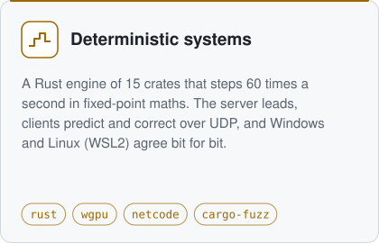
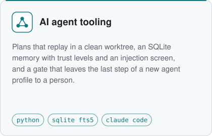
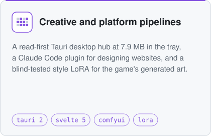
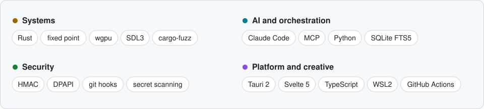

<picture>
  <source media="(prefers-color-scheme: dark)" srcset="assets/hero-dark.svg">
  <source media="(prefers-color-scheme: light)" srcset="assets/hero-light.svg">
  
</picture>

I build deterministic game systems, tooling for AI agents, and the guardrails that keep both safe to run. I set the direction and the rules, Claude Code agents write most of the code, and nothing ships without a test, a benchmark or a written limit.

Most of my time goes into [Errastra](https://errastra.com), a 60 Hz co-op game on its own Rust engine. I started programming in March 2026.

<table>
  <tr>
    <td width="50%">
      <a href="https://github.com/harveyjenkins03-coder/errastra-engine-notes">
        <picture>
          <source media="(prefers-color-scheme: dark)" srcset="assets/card-systems-dark.svg">
          <source media="(prefers-color-scheme: light)" srcset="assets/card-systems-light.svg">
          
        </picture>
      </a>
    </td>
    <td width="50%">
      <a href="https://github.com/harveyjenkins03-coder/agent-workflow">
        <picture>
          <source media="(prefers-color-scheme: dark)" srcset="assets/card-agents-dark.svg">
          <source media="(prefers-color-scheme: light)" srcset="assets/card-agents-light.svg">
          
        </picture>
      </a>
    </td>
  </tr>
  <tr>
    <td width="50%">
      <a href="https://github.com/harveyjenkins03-coder/mcp-secret-broker">
        <picture>
          <source media="(prefers-color-scheme: dark)" srcset="assets/card-security-dark.svg">
          <source media="(prefers-color-scheme: light)" srcset="assets/card-security-light.svg">
          
        </picture>
      </a>
    </td>
    <td width="50%">
      <a href="https://github.com/harveyjenkins03-coder/errastra-hub-notes">
        <picture>
          <source media="(prefers-color-scheme: dark)" srcset="assets/card-platform-dark.svg">
          <source media="(prefers-color-scheme: light)" srcset="assets/card-platform-light.svg">
          
        </picture>
      </a>
    </td>
  </tr>
</table>

<picture>
  <source media="(prefers-color-scheme: dark)" srcset="assets/4d-loop-dark.svg">
  <source media="(prefers-color-scheme: light)" srcset="assets/4d-loop-light.svg">
  
</picture>

## Selected work

| Repository | Area | Proof |
|---|---|---|
| [errastra-engine-notes](https://github.com/harveyjenkins03-coder/errastra-engine-notes) | Systems | Server tick p99 of 361 to 372 µs with 100 enemies, 8 ms budget |
| [agent-workflow](https://github.com/harveyjenkins03-coder/agent-workflow) | AI agents | 131 tests, no runtime dependencies |
| [mcp-secret-broker](https://github.com/harveyjenkins03-coder/mcp-secret-broker) | Security | 76 tests, and no tool returns a secret |
| [errastra-hub-notes](https://github.com/harveyjenkins03-coder/errastra-hub-notes) | Desktop | 7.9 MB private memory in the tray, no web view |
| [portfolio-shield](https://github.com/harveyjenkins03-coder/portfolio-shield) | Tooling | Scans every git object, 33 tests |
| [lab-notes](https://github.com/harveyjenkins03-coder/lab-notes) | Experiments | 1.8 s an image on a rented card, 12.9 s on my PC |

Each repository explains how its numbers were measured.

<picture>
  <source media="(prefers-color-scheme: dark)" srcset="assets/tools-dark.svg">
  <source media="(prefers-color-scheme: light)" srcset="assets/tools-light.svg">
  
</picture>

How a change gets from an idea to main

1. I write the plan first: what the change must do, what it must not touch, and how we will know it works.
2. Claude Code agents do the work, with short leases instead of keys and hooks that refuse private details.
3. Tests and benchmarks run, and the larger changes go to a separate reviewer agent. I read its findings and decide.
4. Nothing merges until the gates pass. Each repository says which parts were mine and which were the AI's.

It is a habit, not a guarantee, and the repositories list what was not checked.

Where the numbers come from

Most timings come from one desktop PC (Ryzen 9 5900X, Windows 11 Pro, with WSL2 for the Linux leg); the lab notes also use a rented graphics card and say which. Where a number was estimated rather than measured, the repository says so.

[hello@errastra.com](mailto:hello@errastra.com) · [errastra.com](https://errastra.com)
