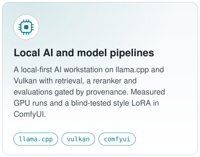

<picture>
  <source media="(prefers-color-scheme: dark)" srcset="assets/hero-dark.svg">
  <source media="(prefers-color-scheme: light)" srcset="assets/hero-light.svg">
  
</picture>

I build AI systems that run locally and fail safe: least-privilege guardrails for agents, local inference and generative pipelines, and the deterministic systems underneath. Right now that means a local-first AI workstation, the agent tooling around it, and [Errastra](https://errastra.com), a co-op game on its own Rust engine.

<a href="https://github.com/harveyjenkins03-coder/mcp-secret-broker"><picture><source media="(prefers-color-scheme: dark)" srcset="assets/card-security-dark.svg"><source media="(prefers-color-scheme: light)" srcset="assets/card-security-light.svg"></picture></a> <a href="https://github.com/harveyjenkins03-coder/aegis-notes"><picture><source media="(prefers-color-scheme: dark)" srcset="assets/card-model-dark.svg"><source media="(prefers-color-scheme: light)" srcset="assets/card-model-light.svg"></picture></a> 
<a href="https://github.com/harveyjenkins03-coder/agent-workflow"><picture><source media="(prefers-color-scheme: dark)" srcset="assets/card-agents-dark.svg"><source media="(prefers-color-scheme: light)" srcset="assets/card-agents-light.svg"></picture></a> <a href="https://github.com/harveyjenkins03-coder/errastra-engine-notes"><picture><source media="(prefers-color-scheme: dark)" srcset="assets/card-layers-dark.svg"><source media="(prefers-color-scheme: light)" srcset="assets/card-layers-light.svg"></picture></a>

<picture>
  <source media="(prefers-color-scheme: dark)" srcset="assets/4d-loop-dark.svg">
  <source media="(prefers-color-scheme: light)" srcset="assets/4d-loop-light.svg">
  
</picture>

## Proof

| Repository | What it shows |
|---|---|
| [aegis‑notes](https://github.com/harveyjenkins03-coder/aegis-notes) | A local-first AI workstation and its OS-layer design: 52 to 56 tok/s decode on a 12 GB consumer GPU, 443 tests |
| [mcp‑secret‑broker](https://github.com/harveyjenkins03-coder/mcp-secret-broker) | Agents use API keys they never see: leases, signed state, a reply censor, 76 tests |
| [lab‑notes](https://github.com/harveyjenkins03-coder/lab-notes) | Measured experiments, failures included: a LoRA blind test, GPU runs, local model tuning |
| [agent‑workflow](https://github.com/harveyjenkins03-coder/agent-workflow) | Replayable agent plans and a gated memory: 131 tests, no runtime dependencies |
| [web‑studio‑plugin](https://github.com/harveyjenkins03-coder/web-studio-plugin) | A Claude Code plugin that takes a website through five reviewed design steps |
| [errastra‑engine‑notes](https://github.com/harveyjenkins03-coder/errastra-engine-notes) | Deterministic 60 Hz Rust: server tick p99 of 361 to 372 µs against an 8 ms budget |
| [portfolio‑shield](https://github.com/harveyjenkins03-coder/portfolio-shield) | A leak scanner that reads every git object, with commit and push hooks |
| [errastra‑hub‑notes](https://github.com/harveyjenkins03-coder/errastra-hub-notes) | A Tauri 2 and Svelte 5 desktop hub at 7.9 MB private memory in the tray |

Each repository explains how its numbers were measured.

How I work, and where AI fits

I work in the 4D loop from Anthropic's AI Fluency course: delegation, description, discernment and diligence.

- I design each system, write its plan and rules, decide the trade-offs and sign off the evidence.
- Claude Code agents write most of the code, inside hooks, short-lived leases and tests. Each repository says which parts were mine and which the AI's.
- Nothing merges until its gates pass, and a separate reviewer agent reads the larger changes before I do.
- I started programming in March 2026. Timings come from one desktop PC (Ryzen 9 5900X, Radeon RX 7700 XT, Windows 11 with WSL2 and Hyper-V); the lab notes also use a rented graphics card and say so.

Security work: what I publish and what stays private

I publish architecture, defensive methods and threat models. I never publish targets, programs, findings, exploit code, payloads or captured data, and offensive testing belongs only inside a scope its owner has authorised.

[hello@errastra.com](mailto:hello@errastra.com) · [errastra.com](https://errastra.com)
