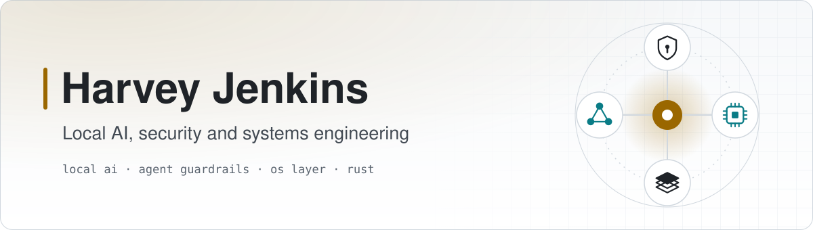
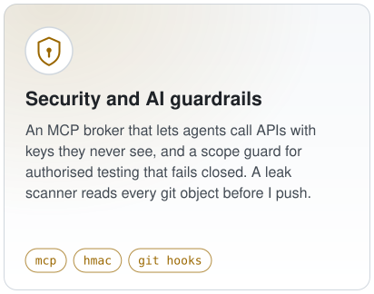
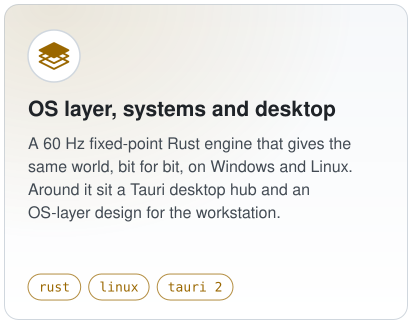
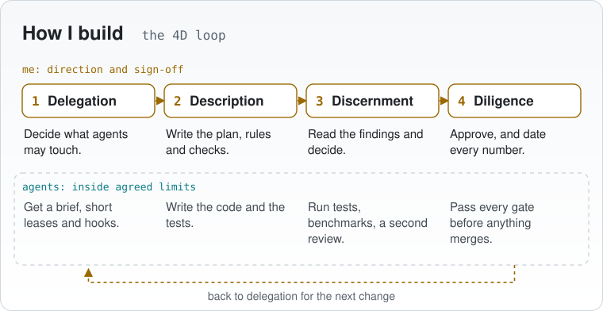

<picture>
  <source media="(prefers-color-scheme: dark)" srcset="assets/hero-dark.svg">
  <source media="(prefers-color-scheme: light)" srcset="assets/hero-light.svg">
  
</picture>

I grew up tinkering with computers, hardware and security, and I learn best by building real systems end to end, then measuring them on my own machine. Right now that's a local-first AI workstation, guardrails that keep coding agents in bounds, and [Errastra](https://errastra.com), a co-op game on its own Rust engine.

<a href="https://github.com/harveyjenkins03-coder/mcp-secret-broker"><picture><source media="(prefers-color-scheme: dark)" srcset="assets/card-security-dark.svg"><source media="(prefers-color-scheme: light)" srcset="assets/card-security-light.svg"></picture></a> <a href="https://github.com/harveyjenkins03-coder/aegis-notes"><picture><source media="(prefers-color-scheme: dark)" srcset="assets/card-model-dark.svg"><source media="(prefers-color-scheme: light)" srcset="assets/card-model-light.svg"></picture></a> 
<a href="https://github.com/harveyjenkins03-coder/agent-workflow"><picture><source media="(prefers-color-scheme: dark)" srcset="assets/card-agents-dark.svg"><source media="(prefers-color-scheme: light)" srcset="assets/card-agents-light.svg"></picture></a> <a href="https://github.com/harveyjenkins03-coder/errastra-engine-notes"><picture><source media="(prefers-color-scheme: dark)" srcset="assets/card-layers-dark.svg"><source media="(prefers-color-scheme: light)" srcset="assets/card-layers-light.svg"></picture></a>

<a href="https://github.com/harveyjenkins03-coder/agent-workflow/blob/main/docs/workflow-telemetry-2026-11.md"><picture><source media="(prefers-color-scheme: dark)" srcset="assets/telemetry-dark.svg"><source media="(prefers-color-scheme: light)" srcset="assets/telemetry-light.svg"></picture></a>

Claude Code's `/insights` report for 27 October to 26 November 2026 counted 382 commits and 350 subagent runs in my sessions. [The dated note](https://github.com/harveyjenkins03-coder/agent-workflow/blob/main/docs/workflow-telemetry-2026-11.md) says what those counts cover and what went wrong along the way.

<picture>
  <source media="(prefers-color-scheme: dark)" srcset="assets/4d-loop-dark.svg">
  <source media="(prefers-color-scheme: light)" srcset="assets/4d-loop-light.svg">
  
</picture>

## Proof

| Repository | What it shows |
|---|---|
| [mcp‑secret‑broker](https://github.com/harveyjenkins03-coder/mcp-secret-broker) | Agents use API keys they never see: leases, signed state, a reply censor, 76 tests |
| [aegis‑notes](https://github.com/harveyjenkins03-coder/aegis-notes) | A local-first AI workstation and its OS-layer design: 52 to 56 tok/s decode on a 12 GB consumer GPU, 443 tests |
| [agent‑workflow](https://github.com/harveyjenkins03-coder/agent-workflow) | Replayable agent plans and a gated memory: 131 tests, no runtime dependencies |
| [scope‑guard](https://github.com/harveyjenkins03-coder/scope-guard) | Is this target in the engagement's scope? Fails closed, with a test per bypass class |
| [portfolio‑shield](https://github.com/harveyjenkins03-coder/portfolio-shield) | A leak scanner that reads every git object, with commit and push hooks |
| [errastra‑engine‑notes](https://github.com/harveyjenkins03-coder/errastra-engine-notes) | Deterministic 60 Hz Rust: server tick p99 of 361 to 372 µs against an 8 ms budget |
| [lab‑notes](https://github.com/harveyjenkins03-coder/lab-notes) | Measured experiments, failures included: a LoRA blind test, GPU runs, local model tuning |
| [assessment‑console‑notes](https://github.com/harveyjenkins03-coder/assessment-console-notes) | An assessment console for authorised testing: its design, threat model and why I archived it |
| [errastra‑hub‑notes](https://github.com/harveyjenkins03-coder/errastra-hub-notes) | A Tauri 2 and Svelte 5 desktop hub at 7.9 MB private memory in the tray |
| [web‑studio‑plugin](https://github.com/harveyjenkins03-coder/web-studio-plugin) | A Claude Code plugin that takes a website through five reviewed design steps |

Each repository explains how its numbers were measured.

How I work, and where AI fits

I chose hard, real problems on purpose, because they show me quickly where my understanding is wrong. I work in the 4D loop from Anthropic's AI Fluency course.

- **Learning.** If I can benchmark something on my own hardware, I don't guess. Failed runs stay in my lab notes next to the ones that worked.
- **Ownership.** Claude Code agents write most of the code, inside hooks and tests. I write the specs and security boundaries, make the trade-offs and do the final check before anything merges.
- **Mistakes.** When a review found a bypass in my shell guard, the fix started as a failing test. When agents kept breaking files through the Windows shell, I added a hook that refuses those edits.
- **Limits.** Each repository says which parts were mine and which the AI's, and what its tools do not stop. Benchmarks carry a date, and anything not built yet is labelled as a plan.

Timings come from one desktop PC (Ryzen 9 5900X, Radeon RX 7700 XT, Windows 11 with WSL2 and Hyper-V); the lab notes also use a rented graphics card and say so.

Security work: what I publish and what stays private

I publish architecture, defensive methods and threat models. My testing has been on my own lab machines and isolated networks, and in bug-bounty programmes strictly under their published rules. I never publish targets, programmes, findings, exploit code, payloads or captured data, and offensive testing belongs only inside a scope its owner has authorised.

[hello@errastra.com](mailto:hello@errastra.com) · [errastra.com](https://errastra.com)
