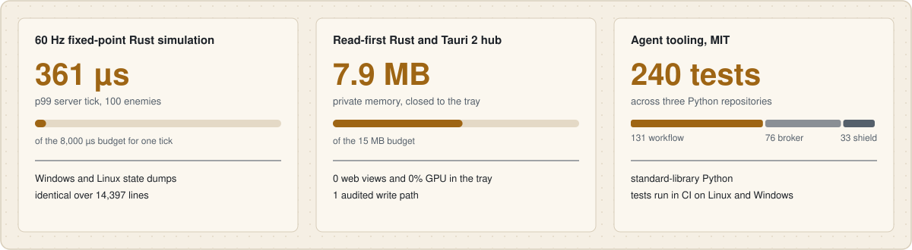

<picture>
  <source media="(prefers-color-scheme: dark)" srcset="assets/banner-dark.png">
  
</picture>

I'm Harvey. I started programming in March 2026 with a small Python tool and got hooked on how systems fail at the seams: between a client and a server, between two operating systems that ought to agree, between what a test checks and what a person sees.

Most of my time now goes into [Errastra](https://errastra.com), a 2D co-op game on its own engine in Rust. The simulation steps 60 times a second in fixed-point arithmetic, so the same inputs give the same world on Windows and Linux, bit for bit, and the build fails if they ever differ. Around the game I build the tools I need: a desktop dashboard, a kit for planning agent work, a broker that keeps keys away from AI agents, and a scanner that keeps private details out of repositories like this one.

## How I work

I build with Claude Code. I write the design and the rules first, make the calls on scope and trade-offs, and read what comes back. Claude writes most of the code. Changes go through tests and benchmarks, and the larger ones through a review by a separate AI agent, before I read the result and decide. It is a habit, not a guarantee, and each repository below says plainly which parts were mine and which were the AI's.

<picture>
  <source media="(prefers-color-scheme: dark)" srcset="assets/systems-overview-dark.svg">
  
</picture>

## Work

| Repository | What it is | One measured number |
|---|---|---|
| [errastra-engine-notes](https://github.com/harveyjenkins03-coder/errastra-engine-notes) | Notes on the game's simulation: one authoritative server, prediction and correction, cross-OS state checks, the test gates | Server tick with 100 enemies: p99 of 361 µs against an 8,000 µs budget |
| [agent-workflow](https://github.com/harveyjenkins03-coder/agent-workflow) | Replayable plans, a small SQLite memory with an injection screen, and a gate for agent profiles | 131 tests |
| [errastra-hub-notes](https://github.com/harveyjenkins03-coder/errastra-hub-notes) | Notes on a read-first desktop dashboard (Rust, Tauri 2, Svelte 5) with one audited write path | 7.9 MB in the tray, no web view, 0% GPU |
| [mcp-secret-broker](https://github.com/harveyjenkins03-coder/mcp-secret-broker) | Short leases instead of keys for AI agents, signed state, and a censor on every reply | 76 tests |
| [portfolio-shield](https://github.com/harveyjenkins03-coder/portfolio-shield) | Scans every object in a git repository for private details, with commit and push hooks | 33 tests, standard library only |
| [lab-notes](https://github.com/harveyjenkins03-coder/lab-notes) | Measured experiments, including the ones that did not work | 1.8 s an image on a rented card against 12.9 s on my PC |

Dates, machines and methods for each number are in the repositories.

## What I build with

- **Systems:** Rust, fixed-point simulation, Cargo workspaces, fuzzing and benchmarks
- **Interfaces:** Tauri 2, Svelte 5, TypeScript, Astro
- **Tooling and security:** Python, SQLite, PostgreSQL, git hooks, Windows DPAPI, GitHub Actions, Linux and WSL
- **Working with AI:** Claude Code, MCP servers, written plans, and review by a separate AI agent before I sign off

## Contact

[hello@errastra.com](mailto:hello@errastra.com) or [errastra.com](https://errastra.com)
